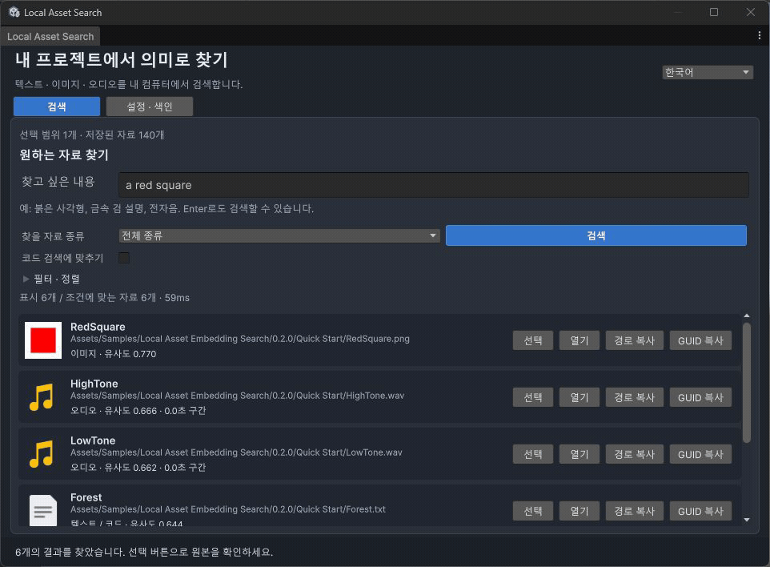

# Local Asset Search for Unity

[English](README.en.md)

Unity Editor에서 **텍스트·이미지·오디오를 의미로 검색**하는 UPM 패키지입니다. 한국어 UI를 기본으로 제공하며 영어로 전환할 수 있습니다. 추론은 격리된 로컬 Python 프로세스가 담당합니다. Sentis/Inference Engine, 런타임 컴포넌트, 특정 렌더 파이프라인 의존성이 없습니다.



GIF는 실제 에디터 화면을 단계별로 캡처한 안내입니다. 재생 시간은 처리 속도 측정값이 아닙니다.

## 처음 사용하기

1. Unity **Window > Package Manager > + > Install package from disk**에서 이 저장소의 `package.json`을 선택합니다. 배포용 `.tgz`는 tarball 설치 메뉴를 사용합니다.
2. **Tools > Local Asset Search > 설정 · 색인**을 엽니다. Python 3.11~3.13이 없다면 먼저 설치합니다. **권장 설정으로 Python 환경 준비**를 누르면 프로젝트 Library 안에 별도 환경을 만듭니다. 전역 Python 패키지는 변경하지 않습니다. NVIDIA GPU는 자동으로 CUDA 환경을 선택합니다.
3. 기존 Hugging Face 원본 **EmbeddingGemma 2 모델 폴더**를 지정합니다. 없으면 빈 다운로드 대상 폴더를 지정하고 다운로드합니다. 필요 파일만 고정 리비전에서 받으며 ONNX/GGUF 변환은 필요 없습니다. 기존 체크포인트는 덮어쓰지 않습니다. 처음 다운로드하기 전에 Python 환경을 준비하세요.
4. **모델 불러오기 · 연결 확인**을 누릅니다. **샘플로 먼저 체험** 또는 **폴더 추가**로 필요한 범위만 지정합니다. 프로젝트 전체를 자동 색인하지 않습니다.
5. **자료 수 확인 → 선택한 자료 색인 · 갱신**을 누릅니다. 완료되면 검색 탭으로 이동합니다. 다음부터 변경되지 않은 파일은 다시 임베딩하지 않습니다.
6. 검색어와 자료 종류를 선택합니다. 예: `a red square`, `metal sword and shield`, `an electronic tone`. 결과의 **선택**으로 Project 창에서 찾고 **열기**로 원본을 확인합니다. 오디오는 Inspector에서 재생할 수 있습니다.

검색 탭의 입력·필터는 고정되고 결과 목록만 스크롤합니다. 설치·폴더 관리·진단은 별도 설정 탭에 있습니다. 밝은 테마 스타일도 포함하지만 실제 화면 검증은 어두운 테마에서 수행했습니다.

**필터 · 정렬**에서는 낮은 유사도 숨기기와 최소 코사인(-1~1), 유사도/이름/경로 정렬, 최대 10/20/50/100개, 경로 포함 문자열과 확장자(`png,jpg` 또는 `cs,shader`)를 지정합니다. 기본 정렬은 유사도 높은 순이며 하한선은 선택 기능입니다. 점수는 확률이 아니므로 오디오·이미지·텍스트에 같은 기준을 강제하지 않습니다. 조건 변경 후 검색을 다시 누르세요. 이름·경로 정렬은 조건에 맞는 전체 자료를 정렬한 다음 결과 수를 적용합니다. 결과의 경로·GUID를 복사하거나 미리보기 아이콘을 씬/Inspector로 드래그할 수 있습니다.

## AI 에이전트에서 바로 호출

MCP stdio 서버 `Agent~/mcp_server.py`를 등록하면 Computer Use 없이 다음 도구를 호출합니다.

```text
unity_asset_status({})
unity_asset_search({"query":"a red square", "kind":"image", "top":5})
```

CLI도 사용할 수 있습니다. Python 표준 라이브러리만 필요합니다.

```powershell
python "<package>/Agent~/search.py" --project "<project>" --query "a metal sword" --kind text --top 10
```

[MCP 설정·C# Editor API](Agent~/README.md)와 [선택적 에이전트 스킬](Agent~/skills/unity-asset-search/SKILL.md)을 제공합니다. 읽기 전용 에이전트 자격 증명은 검색·상태 조회만 허용하고 에디터의 최신 포함/제외 범위를 서버가 강제합니다. 색인 작업도 Unity main thread에서 공개 C# API로 직접 실행할 수 있습니다. 전역 에이전트 설정은 자동 변경하지 않습니다.

## 성능과 구현 수준

실제 모델과 Unity 수집·미리보기·HTTP·SQLite 경로로 측정했습니다. [벤치마크 원본과 재현 방법](Documentation~/BENCHMARKS.md)을 확인하세요. 짧은 합성 자료 결과이므로 실제 대규모 프로젝트의 검색 정확도나 처리량을 보장하지 않습니다.

- CUDA 텍스트 배치 64, CPU 8, 이미지 4, 오디오 2; 메모리 부족 시 배치를 절반으로 줄입니다. 텍스트·오디오 청크는 개별 파일 단위로 원자적으로 저장합니다.
- 내용 해시 기반 증분 색인, importer 설정을 바꾸지 않는 이미지 미리보기 캐시, 64개 검색어 벡터 캐시를 사용합니다.
- SQLite에서 범위·제외·종류를 먼저 적용한 뒤 벡터를 읽고 정확한 코사인 순위를 계산합니다. BF16 출력은 FP32에서 다시 정규화합니다.
- 취소, 항목별 실패 격리, 모델/차원/전처리/라이브러리 지문 불일치 감지, 프로세스 수명 관리, UTF-8 stdout/stderr와 JSON, 한국어/영어 로케일 검증을 포함합니다.

상용 대규모 검색 엔진을 완성했다는 의미는 아닙니다. 최대 10,000개 에셋의 선택 범위와 정확 탐색을 기준으로 구현했습니다. ANN, 자동 파일 변경 감시, 비디오, AnimationClip 분석, 3D/프리팹 렌더링, macOS MPS, Linux/macOS 실제 실행 검증은 포함하지 않습니다. GPU OOM 축소 경로는 실제 OOM 유발 실험을 하지 않았습니다.

## 호환성·저장 위치

UPM의 최소 선언은 Unity 2021.3입니다. 실제 버전별 검증과 미검증 범위는 [호환성 표](Documentation~/COMPATIBILITY.md)에 따릅니다. 이후 Unity 버전 전체를 보장하지 않습니다.

설정은 `UserSettings/LocalAssetSearch.asset`, 생성 데이터·격리 환경·에이전트 접속 정보는 `Library/LocalAssetSearch/`에 저장합니다. 모델은 사용자가 지정한 별도 폴더에 둡니다. 이 파일들을 소스 관리에 포함하지 마세요. 에셋 내용은 설치/추론 과정에서 외부로 보내지 않습니다. 네트워크는 명시적 환경 설치와 모델 다운로드에만 사용합니다.

자세한 형식·제한·HTTP 경계는 [기술 안내](Documentation~/README.md)에 있습니다. 다운로드가 모델 동의나 인증을 요구하면 Hugging Face 표준 절차를 사용하세요. 패키지 UI에 토큰을 저장하지 않습니다.

## 참고

[ayutaz/unity-embeddinggemma-2](https://github.com/ayutaz/unity-embeddinggemma-2)는 Sentis 접근을 비교한 참고 자료입니다. 이 패키지는 별도 구현이며 해당 저장소의 검증 결과를 승계하지 않습니다. 모델은 [google/embeddinggemma-2](https://huggingface.co/google/embeddinggemma-2), 리비전 `914f7f89142e33e77833254d9c9b90c3cef7303b`입니다. 가중치는 배포하지 않으며 원본 모델의 배포 조건이 적용됩니다. 샘플 이미지·문서·톤은 이 패키지 검증을 위해 직접 만든 자료입니다.
